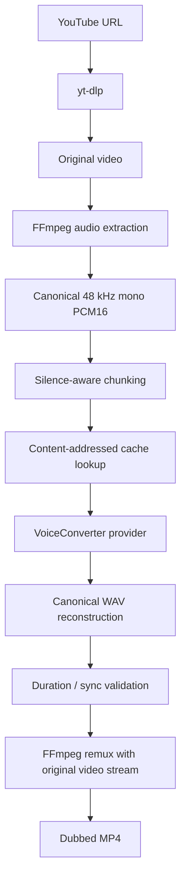

# DubShift

DubShift is a command-line tool for **speech-to-speech video redubbing**: it
replaces a speaker's voice in a video while preserving the original video's
timing and visual stream. Point it at a YouTube URL and a target voice, and
it downloads the video, converts the spoken audio to that voice, and remuxes
the result into a new MP4 with the original picture untouched.

DubShift is more than a thin wrapper around a voice-conversion API. Turning
a single-request voice API into something that works on real, long-form
video requires segmentation, reconstruction, duration/sync validation,
failure recovery, caching, and remuxing -- all of which DubShift implements
itself. See [Why not just call a voice API?](#why-not-just-call-a-voice-api)
below.

## Usage

```bash
dubshift dub \
  "https://www.youtube.com/watch?v=..." \
  --provider elevenlabs \
  --voice VOICE_ID \
  --output dubbed.mp4
```

This runs the full pipeline: download the video, extract its audio, convert
the voice (automatically chunking and reconstructing if the audio is long),
and remux the converted audio back into the original video.

Each stage is also available as its own command (`dubshift download`,
`dubshift extract`, `dubshift convert`, `dubshift remux`) for testing or
using a single step in isolation -- run `dubshift --help` for the full list.

## Architecture



### What's technically interesting here

- **Pluggable `VoiceConverter` protocol** -- a small `typing.Protocol`
  (`convert(input_audio, *, voice, output_path) -> Path`) that every
  provider implements. The rest of the pipeline never knows (or cares)
  whether a provider calls a cloud API or runs a local model.
- **Silence-aware segmentation** -- audio longer than a provider's
  single-request duration limit is split at a detected pause near the
  target chunk length (via ffmpeg's `silencedetect`), falling back to a
  hard cutoff only when no nearby pause exists.
- **Per-chunk and whole-file duration invariants** -- every converted
  chunk's duration is checked against its source chunk, and the fully
  reconstructed output's total duration is checked against the original
  source -- both within a small tolerance. A violation fails loudly rather
  than silently drifting out of sync.
- **Canonical audio normalization** -- whatever codec/container a provider
  returns (e.g. ElevenLabs returns mp3) is decoded to one fixed PCM format
  (16-bit, 48 kHz, mono WAV) before reassembly, so reconstruction is always
  a lossless, identical-format concatenation.
- **Content-addressed SHA-256 conversion cache** -- each chunk is cached
  under a hash of its exact audio bytes plus the target voice and provider
  identity (including model/settings), so re-running a conversion never
  re-pays for identical content.
- **Resumable conversion after provider/network failures** -- because the
  cache is keyed by content and lives outside any temporary directory, a
  `dubshift dub` run that fails partway through (quota error, network
  blip, etc.) can be retried and will skip every chunk that already
  converted successfully.
- **Atomic cache publication** -- cache entries (and final outputs) are
  written to a temp file and atomically renamed into place, so a crash
  never leaves a corrupt or partial cache entry or output file.
- **Original video stream copied, never re-encoded** -- the final remux
  uses ffmpeg's `-c:v copy`, so the picture is byte-for-byte identical to
  the source; only the audio track changes.
- **Structured provider error handling** -- ElevenLabs API errors are
  parsed for their structured `status`/`code`/`message` fields to produce
  actionable error messages (e.g. distinguishing `quota_exceeded` from
  `invalid_api_key`), without ever including the API key in a message.
- **Progress reporting** -- a lightweight callback (no logging framework)
  reports each pipeline stage as it starts, including whether a chunk was
  actually converted or served from the cache.
- **Temporary-file cleanup and overwrite protection** -- all intermediate
  files live in a `TemporaryDirectory` that's removed on success or
  failure, and every stage refuses to silently overwrite an existing
  output file.

## Why not just call a voice API?

A voice-conversion API call by itself only handles one short clip. Turning
that into something that works on a real video requires:

- **Segmentation** -- providers cap request duration (ElevenLabs' Voice
  Changer endpoint currently caps around 5 minutes); most videos are
  longer, so the audio has to be split into provider-safe chunks.
- **Format normalization** -- providers return audio in their own
  codec/container (ElevenLabs returns mp3), which has to be decoded to a
  consistent format before anything can be reassembled.
- **Reconstruction** -- converted chunks must be losslessly stitched back
  into one continuous track, in order, with no gaps or overlaps.
- **Synchronization** -- the reconstructed audio's duration has to be
  validated against the original timing, both per chunk and for the whole
  file, or small provider-side rounding differences would silently
  accumulate into audio/video drift.
- **Failure recovery** -- a long video can require many provider requests;
  any one can fail (quota, network, transient errors), and restarting the
  whole job from scratch would waste both money and time.
- **Caching** -- paid API calls shouldn't be repeated for content that
  already converted successfully.
- **Remuxing** -- the converted audio ultimately has to be swapped back
  into the original video container without touching the video stream.

DubShift exists to handle all of that end-to-end, not just the API call in
the middle.

## Installation

### Requirements

- Python 3.12+
- [FFmpeg](https://ffmpeg.org/) installed and on `PATH` (used for audio
  extraction, chunking, decoding, and remuxing)

### Install

```bash
# from the project root
python3 -m venv .venv
source .venv/bin/activate   # Windows: .venv\Scripts\activate

pip install -e ".[dev]"
```

### Configure your ElevenLabs API key

The ElevenLabs provider reads its key directly from the `ELEVENLABS_API_KEY`
environment variable at run time -- DubShift does not read `.env` files
itself, so creating one has no effect unless you also load it into your
shell. Export the variable before running `dubshift`:

```bash
export ELEVENLABS_API_KEY="your-own-key-here"
```

`.env.example` is provided only as a template/reminder of which variable to
set, e.g. if you use a separate tool (such as `direnv`, or your shell's own
`.env`-sourcing support) to load it into your environment yourself:

```bash
cp .env.example .env
# edit .env to set ELEVENLABS_API_KEY=..., then load it into your shell
# with whatever mechanism you use, before running dubshift.
```

`.env` is gitignored and must never be committed. DubShift never hardcodes
or logs API keys.

## Testing

```bash
pytest
```

The automated suite mocks every network call (yt-dlp, the ElevenLabs SDK)
and every ffmpeg/ffprobe subprocess call, so it runs with no network
connection and no API key required. Alongside it, the media-handling code
(download merging, audio extraction, chunk-boundary detection, remuxing) has
also been exercised against a real local ffmpeg installation using
synthetically generated test audio/video, to confirm the generated ffmpeg
commands produce correct output -- not just that the Python code calls them
with the expected arguments.

## Benchmarks / results

These are measurements actually observed while building and testing
DubShift -- not projected or estimated figures.

**Real end-to-end test (a real YouTube video, through the ElevenLabs
provider, to a dubbed MP4):**

- Test video length: approximately 16m37s
- Source audio duration measured after extraction: `996.925542` seconds
- Silence-aware chunking produced 4 chunks for this video

**Local smoke tests (synthetic audio/video, fake converters, and the
real content-addressed cache -- no network calls):**

- Remuxing (`replace_audio`) preserves the original video's exact frame
  count -- verified directly with `ffprobe` frame counting after a real
  ffmpeg remux
- Cache retry behavior, using a fake converter against the same
  996.925542-second extracted source audio from the real end-to-end test
  (so the chunk count and content matched): the first conversion invoked
  the converter 4 times (once per chunk); an immediate, identical second
  conversion invoked it 0 times -- all 4 chunks were served from the
  content-addressed cache. Both the originally reconstructed output and
  the cache-served reconstruction measured `996.925542` seconds -- duration
  was preserved exactly whether a chunk came from a fresh conversion or
  the cache.
- Automated test suite: 188 tests currently passing (`pytest`)

## Limitations

- **Cost and quota** -- ElevenLabs' speech-to-speech API is a paid service
  with request quotas; converting longer videos makes multiple requests
  and can consume meaningful API credit.
- **Provider support** -- only ElevenLabs is implemented today. The
  `VoiceConverter` protocol is designed to support additional providers
  (including a future local backend), but none exist yet.
- **Cadence and prosody** -- DubShift performs voice conversion (a timbre
  swap), not re-synthesis. The source speaker's original cadence, pacing,
  and delivery are preserved -- which is what keeps the dub in sync with
  the video, but means DubShift does not re-time or re-emote the
  performance.
- **YouTube downloading** -- `dubshift download`/`dub` fetch video via
  `yt-dlp`. Only use this on videos you own or otherwise have the rights
  or permission to download and redub.
- **No bundled voices** -- DubShift does not ship, bundle, or distribute
  any third-party character or celebrity voice models. You supply your own
  voice -- one you own or have permission to use.

## Roadmap

- A local voice-conversion backend (e.g. an open-weights model), so
  DubShift doesn't require a paid cloud provider for every conversion.
- Richer quality/benchmark tooling -- objective comparisons between source
  and converted audio, beyond today's duration-invariant checks.
- Optional expressive/prosody-aware dubbing, for cases where matching a
  target voice's natural delivery matters more than preserving the
  source's exact cadence.
- A UI, once the CLI pipeline is mature enough to be worth building one on
  top of.

## Project layout

```
src/dubshift/
  cli.py                     # Typer CLI entry point
  downloader.py              # YouTube video download (yt-dlp)
  media.py                   # audio extraction and remux (ffmpeg)
  pipeline.py                # download -> extract -> convert -> remux orchestration
  progress.py                # progress-callback mechanism
  cache.py                   # content-addressed conversion cache
  converters/
    base.py                  # the VoiceConverter protocol
    orchestration.py         # single-request conversion
    chunking.py              # silence-aware chunking, reconstruction, caching
    elevenlabs.py            # ElevenLabs VoiceConverter implementation
    fake.py                  # dependency-free VoiceConverter for tests
tests/                       # pytest suite
```

## License

MIT -- see [LICENSE](LICENSE).
